# SVV'04 app: ontwerp-handoff

Dit document is bedoeld voor wie de SVV'04-app gaat ontwerpen (designer of design-tool). Het beschrijft wat er al bestaat, voor wie de app is, welke data er beschikbaar is, wat de huisstijl is en welke keuzes nog open staan.

Alles onder "Feiten" komt uit de repo, de database of de site zelf. Alles onder "Voorstel" is een uitgangspunt om op te reageren, geen besluit van de club. De open vragen staan onderaan.

**Bijlagen A tot en met F** (onderaan) beschrijven de bestaande site scherm voor scherm met screenshots: navigatie, inhoud, opties en gedrag. De screenshots staan in `docs/app-design/screens/` en zijn gemaakt op de preview (svv04.vercel.app) op 31 oktober 2026, mobiel op 390 px breed en de homepage en menu's ook op 1440 px. Wedstrijden, standen en agenda zijn live data en veranderen.

---

## 1. Opdracht in één alinea

Ontwerp een mobiele app voor SVV'04 Schoonebeek die de website aanvult. De app moet leden, ouders, vrijwilligers en supporters snel bij het clubnieuws, de clubinformatie, de contactpersonen en de slimme assistent brengen. Wedstrijdprogramma, standen en aanwezigheid regelt de officiële Voetbal.nl-app al. De SVV'04-app hoeft die niet na te bouwen, maar moet er wel soepel naar doorverwijzen.

## 2. Feiten over de club

- Voetbalvereniging SVV'04, De Kampen 18, 7761 CK Schoonebeek. Telefoon 0524-531656. Opgericht in 2004 (fusie van sc Oranje en vv Minjak). Enige voetbalvereniging in het dorp.
- Teams: 23 in het CMS. Senioren (zaterdag en zondag, 18+, 35+, 45+, futsal) en jeugd van O7 tot en met O21.
- Sponsors: 62 in het CMS, met een ticker op de homepage en een sponsorpagina. Sponsoring loopt via de sponsorgroep.
- Draait op vrijwilligers. Voor spelende leden is vrijwilligerswerk verplicht, en dit staat prominent op de site.
- Kledingmerk: Stanno. Er is een webshop en een winkel (Sluyters Sport in Coevorden).
- Lopende actie: fundraiser voor de renovatie van de tribune (svv04.nl/tribune), betalen via Mollie. Doel €8.000, stoeltjes à €30 of een vrij bedrag.
- Toon van de club: informeel maar zakelijk ("je", niet "u"), direct, geen marketingtaal.

## 3. Wat er al bestaat

| Wat | Waar | Opmerking voor de app |
| --- | --- | --- |
| Website | svv04.nl (nieuwe site is nog niet live, testen via de Vercel-preview) | Bron van alle content, via Payload CMS |
| Voetbal.nl app van de KNVB | App Store en Google Play | Programma, uitslagen, standen, aanwezigheid, Player of the Match. Op de site staat een uitlegpagina (`/vereniging/voetbal-nl-app`) |
| Assistent "Stel je vraag" | `/assistent` en een band op de homepage en op de "Voor jou"-pagina's | Beantwoordt vragen over club, teams, wedstrijden en contacten. Antwoorden bevatten kaarten (wedstrijd, contact, stand, knop naar pagina) |
| Zoeken | Zoekvenster (`SearchModal`) | Staat in de code, maar de knop "Zoeken" in de header wordt vervangen door "Stel je vraag" zolang de assistent aan staat. Op de preview is er dus geen apart zoekvenster. In het assistentpaneel staan wel snelkoppelingen naar Teams, Programma, Nieuws, Agenda, Contact en Lid worden |
| Contactformulier | `/contact` | Berichten gaan per e-mail naar algemenezaken@svv04.nl |
| Feedback-widget | Component `FeedbackWidget` | Bestaat in de code, maar is nergens ingehangen en staat dus niet op de site |
| Webshop | Stanno ledenshop (externe link) | Alleen doorlinken |
| Tribune-fundraiser | `/tribune` | Betaling via Mollie in de browser |

## 4. Voor wie

De site kent vijf doelgroeppagina's ("Voor jou"): **spelers, ouders, trainers en leiders, vrijwilligers en sponsoren**. Daarnaast komen er ex-leden, supporters uit het dorp en mensen die nog twijfelen of ze lid worden.

Wat die groepen in de app het vaakst nodig hebben (voorstel, gebaseerd op de pagina's op de site):

- **Ouders van jeugdleden:** wie is de trainer of leider, waar en wanneer is de training, hoe geef ik een afmelding door, contributie, vrijwilligerstaak.
- **Spelers:** het eigen team, nieuws, clubkleding.
- **Trainers en leiders:** contact met materiaalbeheer, coördinator jeugd, reglementen en gedragscodes.
- **Vrijwilligers:** taken en functies, de vrijwilligerscoördinator, de Dinsdagmorgenploeg.
- **Sponsoren:** pakketten, advertentieformaten, contact met de sponsorgroep.
- **Supporters en dorpsgenoten:** nieuws, AED, kantine, tribune-actie.

## 5. Uitgangspunt van de app

Voorstel:

1. **Niet dubbelop met Voetbal.nl.** De KNVB-app is de bron voor programma, stand en aanwezigheid. De SVV'04-app toont hooguit "de volgende wedstrijd van mijn team" en verwijst voor de rest door.
2. **Eén bron voor content: de site.** Redacteuren werken in Payload. De app mag geen eigen beheeromgeving krijgen.
3. **Snel naar het antwoord.** De assistent en de zoekfunctie zijn de snelste route voor "waar kan ik ... vinden". Zet ze dus voorop.
4. **Geen account nodig om iets te lezen.** Inloggen is alleen nodig als er persoonlijke functies komen (zie open vragen).
5. **Persoonsgegevens met zorg.** Op de site staan bewust geen privételefoonnummers van mensen zonder contactrecord. Dat moet in de app ook zo blijven.

## 6. Voorgestelde schermen

Prioriteit: **P1** = eerste versie, **P2** = later, **P3** = alleen als er behoefte blijkt.

| Prio | Scherm | Inhoud | Databron |
| --- | --- | --- | --- |
| P1 | Home | Uitgelicht nieuws (hero), laatste 3 berichten, volgende wedstrijd van het favoriete team, snelkoppelingen (Stel je vraag, Contact, Tribune) | Payload `posts`, Club.Dataservice, vaste links |
| P1 | Nieuws | Lijst en detail van berichten, filter op team of categorie | Payload `posts` (titel, uitgelichte afbeelding, `publishedAt`, categorieën, `relatedTeams`, tekst, samenvatting) |
| P1 | Assistent | Chat met kaarten voor wedstrijden, contacten, standen en pagina's | Bestaand endpoint `/api/chat` |
| P1 | Contact | Contactpersonen per onderwerp, kaart met foto, functie, telefoon, e-mail; formulier | Payload `contacts`, `/contact?afdeling=<slug>`-patroon |
| P1 | Club | Over de club, bestuur, organisatie, lidmaatschap en contributie, vrijwilligerswerk, reglementen, ereleden, AED, goede doelen | Payload `pages` (sectie "Vereniging") |
| P2 | Teams | Overzicht senioren en jeugd, teamdetail met foto, begeleiding, programma, uitslagen en stand | Payload `teams`, `team-staff`, Club.Dataservice |
| P2 | Mijn team (favoriet) | Team kiezen, volgende wedstrijd en nieuws van dat team bovenaan | Lokale voorkeur op het toestel |
| P2 | Sponsors | Logo's per niveau, link naar sponsorpagina | Payload `sponsors` |
| P2 | Tribune-actie | Voortgang naar het doel, doneren, stoeltje met naam | `fundraisers`, `donations`, Mollie |
| P2 | Agenda | Clubactiviteiten (geen wedstrijden) | Club.Dataservice `activiteiten` |
| P3 | Pushmeldingen | Nieuws van het eigen team, wijziging in programma | Nog niet aanwezig, zie open vragen |
| P3 | Vrijwilligerstaken | Takenlijst met tijdsbesteding en aanmelden | Payload `pages` (taakblokken) |

Navigatievoorstel: onderaan vier tot vijf tabs. Bijvoorbeeld **Home, Nieuws, Teams, Club, Assistent**. Contact en zoeken via een knop bovenin.

## 7. Huisstijl

Uit `src/app/(frontend)/styles/_variables.scss` en `layout.tsx`:

| Token | Waarde |
| --- | --- |
| Primair (SVV-rood) | `#cc0000` |
| Accent (felrood, markeringen in titels) | `#ff2020` |
| Donker | `#1a1a1a` |
| Licht (achtergrond vlakken) | `#f2f2f2` |
| Wit | `#ffffff` |
| Kopfont | Saira Condensed (valt terug op Impact, Arial Narrow) |
| Broodfont | Outfit (valt terug op Helvetica Neue, Arial) |

Patronen die de site al gebruikt en die in de app herkenbaar mogen terugkomen:

- **Titels met accentwoord:** woorden tussen sterretjes in het CMS worden in de accentkleur gezet (bijvoorbeeld in de sectiekop "eyebrow + grote titel").
- **Banden die om en om wit, licht en donker zijn** op de "Voor jou"-pagina's.
- **Kaarten** met een vaste breedte voor losse blokken: citaat, document, adres, contactpersoon.
- **Contactkaart:** ronde foto, naam, functie, telefoon en e-mail, vaak met een knop naar het formulier.
- **Wedstrijdkaart:** teams, datum en tijd, uitslag of aanvang.
- **Sponsorticker** met logo's die doorlopen.

Logo en iconen in `public/`: `svv04-logo.png`, `logo.webp`, `favicon.svg`, `apple-touch-icon.png`, `web-app-manifest-192x192.png` en `-512x512.png`. De bestaande `site.webmanifest` heeft `display: standalone`, dus de site kan nu al als webapp op het beginscherm.

De breakpoints en de pixelmaten van de site zijn voor het web. Voor de app zijn ze niet bindend.

## 8. Tekst en toon

Alle teksten in de app volgen dezelfde regels als de site en de assistent:

- Nederlands, informeel maar zakelijk. "Je", niet "u".
- Kort en direct. Antwoord eerst, uitleg erna.
- Geen em-dashes. Geen "niet alleen X maar ook Y". Geen verzonnen cijfers. Geen opgeklopte verkooptaal.
- Datums als "zaterdag 10 oktober", tijden als "14:30".
- Teksten komen uit de echte bronnen (de oude site, clubdocumenten, of wat de club zelf aanlevert). Verzin geen content om een scherm te vullen. Gebruik duidelijke placeholders en markeer ze.

## 9. Datamodel in het kort

Payload CMS 3 met PostgreSQL (Neon). Mediabestanden staan in Vercel Blob. Relevante collecties:

- **posts:** `title`, `slug`, `featuredImage`, hero-velden (`heroFeatured`, `heroFrom`, `heroUntil`, `heroImage`, `heroImageMobile`), `publishedAt`, `status`, `categories`, `relatedTeams`, `content` (richText), `excerpt`.
- **teams:** `name`, `slug`, `type` (senior, youth, other), `category` (bijvoorbeeld "Onder 11", "Mannen zondag"), `order`, `teamcode` (Sportlink), `photo`, `sponsors`, `description`.
- **team-staff:** `name`, `role`, `team`. Wordt gesynchroniseerd vanuit Club.Dataservice.
- **contacts:** `name`, `roles[]` (`title`, `topic`, `slug`), `email`, `phone`, `photo`, `group`, `order`, `showInContactForm`, `showOnContactPage`.
- **pages:** `title`, `slug`, `section` (vereniging, commissies, meedoen), `parent`, `hideFromNav`, `content` (richText met eigen blokken).
- **audiences:** de "Voor jou"-pagina's (`heroTitle`, `layout` met blokken `content`, `themes`, `contact`, `assistant`).
- **sponsors:** `name`, `logo`, `url`, `websiteSponsor`, `tier`.
- **fundraisers** en **donations:** voor de tribune-actie.
- **messages:** inzendingen van contactformulier en feedback-widget. Alleen leesbaar voor admins.

Richtext bevat eigen blokken die een app apart moet kunnen tonen of bewust negeren: `ctaBlock`, `contactBlock`, `quoteBlock`, `documentDownloadBlock`, `addressBlock`, `pricingTableBlock`, `taskTableBlock`, `factsBlock`, `optionCardsBlock`, `sectionHeaderBlock`, `packageTiersBlock`, `adFormatsBlock`, `boardMembersBlock`, `teamDirectoryBlock`, `qrCodeBlock`, `appStoreButtonsBlock`. Ontwerp elk blok dat in P1-schermen voorkomt een mobiele variant.

Wedstrijddata (programma, uitslagen, stand, wedstrijddetail, spelers, gebeurtenissen, clubactiviteiten) komt van **Club.Dataservice (Sportlink)** via `src/lib/clubdata/`. De site haalt die data server-side op. Een app moet die niet rechtstreeks aanroepen.

## 10. Technische beperkingen die het ontwerp raken

Feiten:

- De hele site zit nu achter een toegangscode (`SITE_ACCESS_CODE`). `/api/*` is daarvan vrijgesteld. Op livegang vervalt die poort.
- Het contactformulier gebruikt BotID. Een native app kan die controle niet doorlopen. Voor een formulier in de app is dus een andere route of een webview nodig.
- Betalingen lopen via Mollie in de browser. Een betaalscherm in de app moet dus in een in-app browser of externe browser, tenzij er een eigen koppeling komt.
- De assistent is een server-endpoint (`/api/chat`) dat kaarten en tekst teruggeeft. Het is dus geen model dat in de app draait.
- Er zijn nog geen gebruikersaccounts voor leden. Alleen redacteuren hebben een login (rollen admin en editor).
- Er is geen pushinfrastructuur.

Bouwroute is nog niet gekozen. Kandidaten: een webapp (PWA, staat al deels klaar), React Native of Expo, of native SwiftUI met Skip voor Android. Dit hoort bij de open vragen, niet bij het ontwerp.

## 11. Open vragen voor de club

1. **Wat is het doel van de app naast Voetbal.nl?** Alleen nieuws en informatie, of ook echte functies zoals meldingen of afmelden voor training?
2. **Persoonlijk of anoniem?** Moeten leden kunnen inloggen? Zo ja, waarmee (e-mailadres uit de ledenadministratie, zoals bij Voetbal.nl)?
3. **Pushmeldingen:** gewenst? Zo ja, voor welk nieuws en wie beheert dat?
4. **Doneren in de app:** mag dat via een webpagina in de app? Dit moet nog worden gecontroleerd tegen de regels van de App Store en Google Play voor goede doelen en inzamelingen.
5. **Kantine:** de oude site noemde de openingstijden (vrijdag 19:00 tot 23:00, zaterdag en zondag 08:00 tot 19:00). Dit staat nog niet in de nieuwe site. Zijn die tijden nog actueel en moeten ze in de app?
6. **Foto's en beeldmateriaal:** welke foto's mogen in de app (privacy van jeugd)? Wie levert beeld voor teams en nieuws?
7. **Naam en icoon:** "SVV'04" is de naam in de manifest. Is dat ook de appnaam in de stores?
8. **Wie beheert de app** na oplevering (updates, store-accounts)?
9. **Budget en bouwroute:** PWA, cross-platform of native.

## 12. Wat het ontwerp moet opleveren

- Navigatiestructuur en schermoverzicht (P1 volledig, P2 op hoofdlijnen).
- Uitgewerkte schermen voor Home, Nieuws (lijst en detail), Assistent, Contact en Club, in licht thema. Donker thema is optioneel.
- Componenten: nieuwskaart, wedstrijdkaart, contactkaart, documentkaart, sectiekop met accentwoord, knoppen, chips, lege en foutstaten.
- Mobiele variant van de richtext-blokken die in P1-schermen voorkomen.
- Toegankelijkheid: voldoende contrast voor rood op wit en wit op rood, grote aanraakdoelen, ondersteuning voor grotere tekst.
- Iconen en een app-icoon op basis van het bestaande logo.
- Korte notitie over wat bewust niet in de app zit (programma en stand als eigen scherm, aanwezigheid).

## 13. Waar dingen in de repo staan

| Onderwerp | Pad |
| --- | --- |
| Design tokens | `src/app/(frontend)/styles/_variables.scss` |
| Alle SCSS per pagina | `src/app/(frontend)/styles/pages/` |
| Homepage | `src/app/(frontend)/page.tsx`, `src/components/` |
| Collecties | `src/collections/` |
| Richtext-blokken | `src/blocks/` |
| Wedstrijddata | `src/lib/clubdata/` |
| Assistent (prompt, tools) | `src/lib/ai/` en `src/components/assistant/` |
| Vaste clubgegevens | `src/lib/club-info.ts` |
| Logo en iconen | `public/` |
| Projectconventies | `CLAUDE.md` |

---

# Bijlagen: de huidige site in beeld

Alles hieronder is vastgesteld op de preview, niet uit de wensenlijst. De screenshots zijn volledige pagina's. In de screenshots van de teamtabs zie je een kleverige header midden in de pagina: dat is een artefact van de volledige-paginafoto, de header staat in het echt bovenaan.

## A. Navigatie

### A1. Desktop (1440 px)

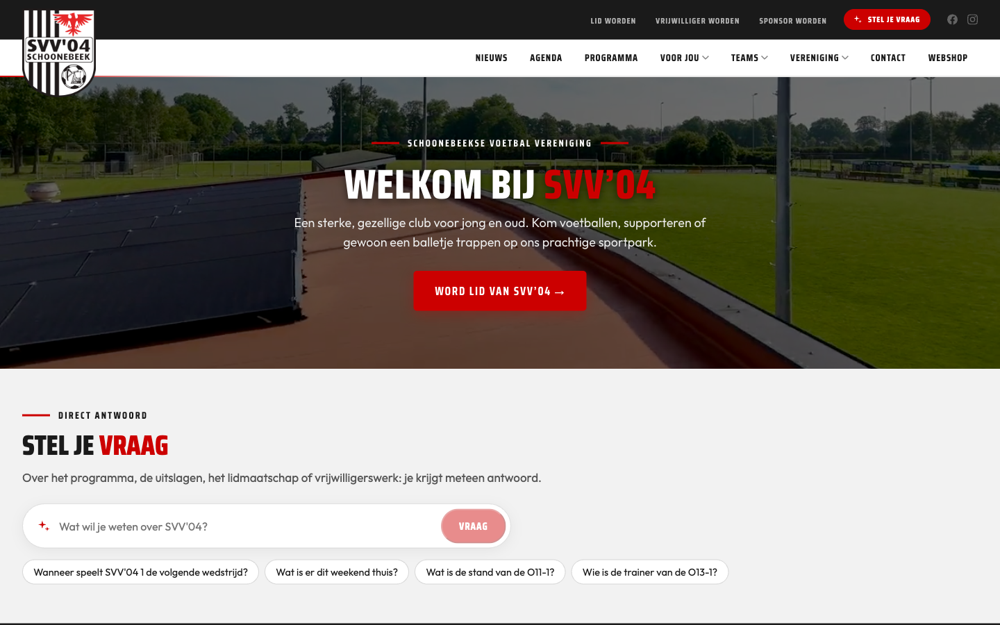

Twee balken boven elkaar:

- **Bovenbalk (donker):** logo (links, steekt over de balk heen), "Lid worden" (`/vereniging/lidmaatschap`), "Vrijwilliger worden" (`/vereniging/vrijwilligerswerk`), "Sponsor worden" (`/sponsoring`), rode knop "Stel je vraag" (opent de assistent), Facebook en Instagram.
- **Hoofdmenu (wit):** Nieuws, Agenda, Programma, **Voor jou** (uitklap), **Teams** (uitklap), **Vereniging** (uitklap), Contact, Webshop (externe link naar Stanno).

Uitklapmenu's openen bij hover:

| Menu | Inhoud |
| --- | --- |
| Voor jou | Spelers, Ouders, Trainers en leiders, Vrijwilligers, Sponsoren (`/sponsoring`) |
| Teams | Alle 23 teams als lijst, senioren eerst, dan jeugd van oud naar jong |
| Vereniging | Algemeen, Bestuur, Clubkleding, De jongste jeugd, Lidmaatschap, Organisatie, Vertrouwenspersoon, Voetbal.nl app, Vrijwilligerswerk, WhatsApp-community (drie kolommen) |

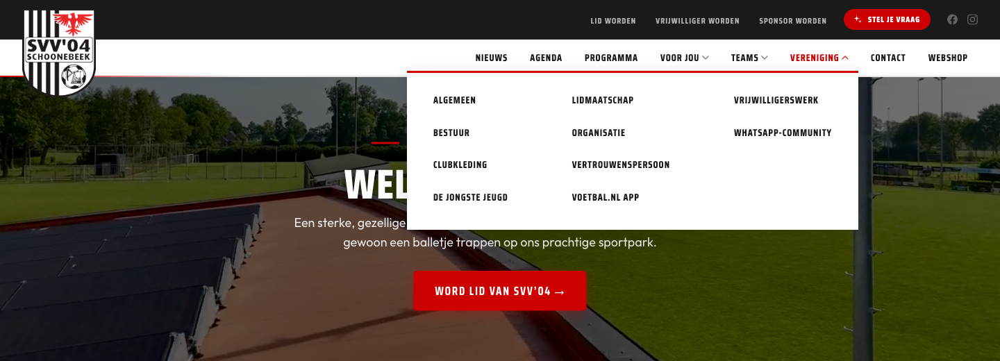
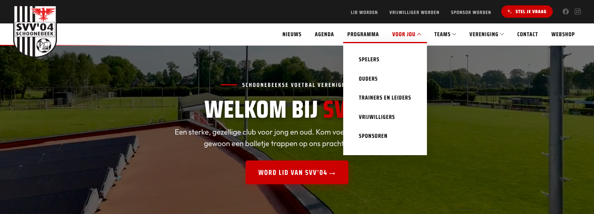
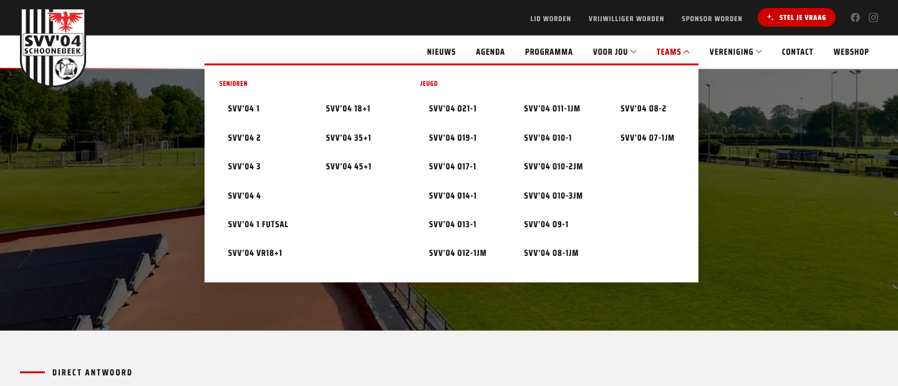

### A2. Mobiel (390 px)

Balk met hamburger links, logo midden en rode knop "Stel je vraag" rechts. Het menu schuift over het scherm:

1. Stel je vraag (opent het assistentpaneel, zie D6)
2. Nieuws
3. Agenda
4. Programma
5. Voor jou (uitklap: Spelers, Ouders, Trainers en leiders, Vrijwilligers, Sponsoren)
6. Teams (gewone link naar `/teams`, **geen** uitklap met 23 teams zoals op desktop)
7. Vereniging (uitklap: dezelfde 10 pagina's als op desktop)
8. Contact
9. Daaronder de actieknoppen uit de bovenbalk: Lidmaatschap, Vrijwilligerswerk, Sponsoring, Webshop

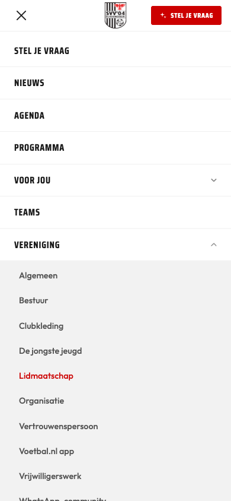

### A3. Voettekst (op elke pagina)

Donker blok met logo en naam "SVV'04", "Schoonebeekse Voetbal Vereniging '04", adres (Sportpark De Kampen, De Kampen 18, 7761 CK Schoonebeek), Facebook en Instagram. Daarna drie lijsten:

- **Navigatie:** Nieuws, Teams, Agenda, Programma, Contact
- **Vereniging:** dezelfde 10 pagina's als in het menu
- **Voor jou:** Spelers, Ouders, Trainers en leiders, Vrijwilligers, Sponsoren

Onderaan: Privacyverklaring, Cookies, Contact en "© 2026 SVV'04 Schoonebeek".

### A4. Kruimelpad

Alle subpagina's hebben een kruimelpad bovenaan: "Home › Teams › SVV'04 1", "Home › Programma › Wedstrijd", "Home › Contact". De "Voor jou"-pagina's tonen alleen "Home › Ouders".

### A5. Pagina's die niet in het menu staan

| Pagina | Hoe je erbij komt |
| --- | --- |
| `/tribune` | Losse actiepagina, linkt naar `svv04.nl`. Niet in menu of footer |
| `/alle-sponsors` | Knop "Onze sponsoren" bij de sponsorticker op de homepage |
| `/wedstrijd/<code>` | Tikken op een wedstrijd in programma, op een teampagina of in een assistentantwoord |
| `/vereniging/taken` (kop "Vrijwilligerstaken") en `/vereniging/advertenties-aanleveren` | Knop vanaf de vrijwilligers- en sponsorpagina's, bewust verborgen voor het menu |
| `/programma/vandaag`, `/deze-week`, `/volgende-week` | Routes bestaan in de code, niet in het menu |
| `/privacy`, `/cookies` | Alleen voettekst |
| `/meedoen` | Route bestaat in de code, geeft op de preview een 404. Niet gebruiken |

## B. Overzicht in één tabel

| # | Pagina | URL | Soort | Kort |
| --- | --- | --- | --- | --- |
| 1 | Home | `/` | samengesteld | Hero, assistent, programma, nieuws, agenda, rolkeuze, sponsors |
| 2 | Nieuws | `/nieuws` | lijst | 4 berichten |
| 3 | Nieuwsbericht | `/nieuws/<slug>` | detail | Titel, foto, tekst met blokken, drie recente berichten |
| 4 | Teams | `/teams` | lijst | 9 senioren en 14 jeugd |
| 5 | Teampagina | `/teams/<slug>` | detail | Foto, selectie, staf, stand, programma, uitslagen, volgende wedstrijd |
| 6 | Programma | `/programma` | live data | Alle wedstrijden per dag, filter thuis of uit |
| 7 | Wedstrijd | `/wedstrijd/<code>` | live data | Kleedkamers, officials, selecties, staf |
| 8 | Agenda | `/agenda` | live data | Clubactiviteiten per maand |
| 9 | Contact | `/contact` | formulier | Onderwerpkeuze, contactkaart, formulier, vaste gegevens |
| 10 | Assistent | `/assistent` | chat | Vragen stellen, antwoorden met kaarten |
| 11 | Voor jou (5x) | `/spelers`, `/ouders`, `/trainers-leiders`, `/vrijwilligers`, `/sponsoring` | samengesteld | Linkgroepen per rol, assistent, contactpersoon, CTA |
| 12 | Vereniging (10+) | `/vereniging/<slug>` | tekstpagina | Richtext met eigen blokken, zijmenu op desktop |
| 13 | Sponsors | `/alle-sponsors` | lijst | Website-sponsors en overige sponsors |
| 14 | Tribune-actie | `/tribune` | actiepagina | Voortgang, plannen, donatieformulier |
| 15 | Privacy en cookies | `/privacy`, `/cookies` | tekst | Lange juridische tekst |

## C. Gedeelde onderdelen

- **Huisstijl:** rood op wit en donker, zware smalle koppen (Saira Condensed, hoofdletters), rustige broodtekst (Outfit). Koppen hebben vaak een kort rood streepje boven zich en een accentwoord in felrood. Zie §7.
- **Wedstrijdkaart:** twee clublogo's, teamnamen (eigen team in rood), datum "ZAT 31 OKT.", groot tijdstip, "Thuis" of "Uit".
- **Contactkaart:** ronde foto, functie als rood label, naam, pijl naar het contactformulier met het onderwerp voorgekozen (`/contact?afdeling=<slug>`).
- **Linkgroep op "Voor jou":** genummerde band (01, 02, 03), kop in hoofdletters, intro, daaronder rijen met titel, een regel uitleg en een pijl rechts.
- **Banden:** inhoud staat in volle breedte banden die om en om wit, licht grijs of donker zijn.
- **CTA-balk:** volle rode band met korte tekst en een witte knop.
- **Lege en foutstaten:** de site toont "Geen programma gevonden." en "Afgeschermd (4x)" voor spelers die hun naam niet laten tonen. Foutschermen en laadstaten zijn niet ontworpen. Dat moet de app wel.

## D. Schermen in detail

### D1. Home

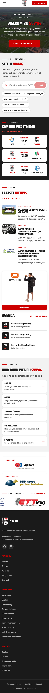

Van boven naar beneden:

1. **Hero:** achtergrondvideo of foto van het sportpark, klein label "Schoonebeekse Voetbal Vereniging", titel "Welkom bij SVV'04", twee regels intro en knop "Word lid van SVV'04". Een redacteur kan hier een uitgelicht nieuwsbericht in zetten (`heroFeatured`, met aparte mobiele afbeelding en looptijd).
2. **"Stel je vraag":** eyebrow "Direct antwoord", titel met accentwoord, een regel uitleg, invoerveld met knop "Vraag" en vier voorbeeldvragen als chips.
3. **"Komende wedstrijden"** (donkere band): drie wedstrijdkaarten van de eigen teams, link "Volledig programma".
4. **"Laatste nieuws":** drie nieuwskaarten (datum, titel, openingszin, foto), link "Bekijk alle nieuws".
5. **Webshopbanner:** foto van Stanno-kleding, knop "Kleding kopen" (externe link).
6. **"Agenda":** drie komende activiteiten met datumblokje (dag, maand), titel, tijd en plek, link "Volledige agenda".
7. **"Vind jouw weg bij SVV'04":** vijf kaarten: Speler, Ouder, Trainer / Leider, Vrijwilliger, Sponsor, elk met een regel uitleg.
8. **Sponsors:** "Hoofdsponsor" en "Hoofdsponsor jeugd" met groot logo, daaronder de doorlopende ticker "Onze sponsoren" met link "Sponsor worden".

Desktop-variant: 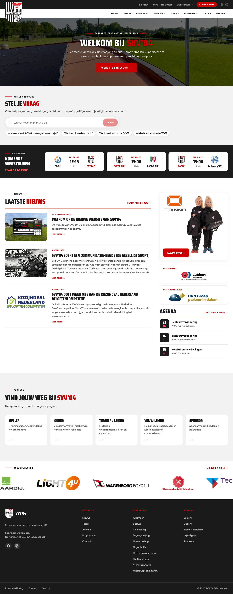

### D2. Nieuws

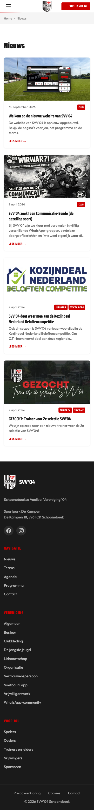
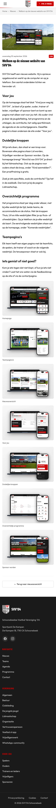

- **Lijst:** kaarten met uitgelichte afbeelding, datum ("30 september 2026"), categorie (Club, Junioren, Senioren), eventueel de gekoppelde teams als chip, titel en samenvatting. Nu 4 berichten. Er is geen filter, zoekveld of paginering op de site.
- **Detail:** titel, afbeelding, daarna richtext met koppen, lijsten, knoppen en afbeeldingen. Onderaan "Laatste Nieuws" met drie andere berichten.
- Het voorbeeld "GEZOCHT: Trainer voor 2e selectie" is een korte vacature: 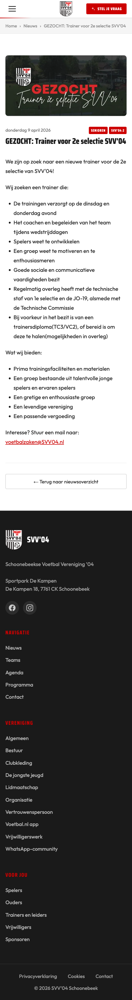

### D3. Teams

Twee groepen: **Senioren** (SVV'04 1, 2, 3, 4, 1 Futsal, VR18+1, 18+1, 35+1, 45+1) en **Jeugd** (O21-1, O19-1, O17-1, O14-1, O13-1, O12-1JM, O11-1JM, O10-1, O10-2JM, O10-3JM, O9-1, O8-1JM, O8-2, O7-1JM). Elke kaart toont teamfoto of een placeholder en de naam.

**Teampagina:**

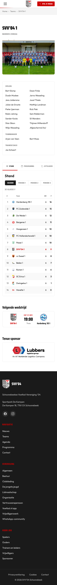
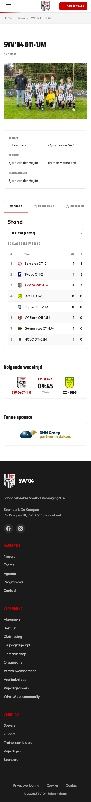

- Naam, categorie ("Mannen zondag") en teamfoto (tikken opent een grote versie).
- Selectie in twee kolommen, daarna Teammanager en Trainer/coach (jeugd: Trainer, Teammanager). Spelers die hun naam niet willen tonen staan als "Afgeschermd (4x)".
- **Tabs:** Stand, Programma, Uitslagen, Indeling en Beker. Welke tabs een team heeft hangt van de competitie af.
  - *Stand:* competitietabel met clublogo, naam, gespeeld, punten, eigen team gemarkeerd, filter Seizoen en Periode 1 tot en met 3.
  - *Programma* en *Uitslagen:* wedstrijdkaarten.
  - *Indeling:* alle teams in de poule met speeldag en aanvangstijd (zaterdag of zondag).
  - *Beker:* kies de bekercompetitie, filter "Alle wedstrijden" of "Eigen club", programma, uitslagen en bekerstand.
- Daaronder "Volgende wedstrijd" en "Tenue sponsor" (logo, linkt naar de sponsor).

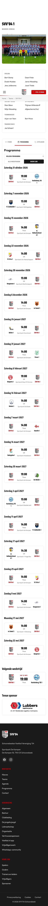
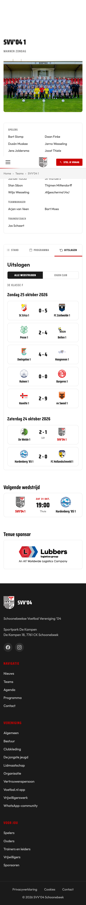
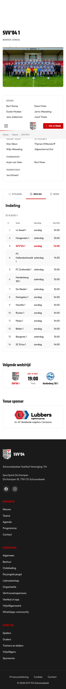
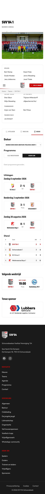

### D4. Programma en wedstrijd

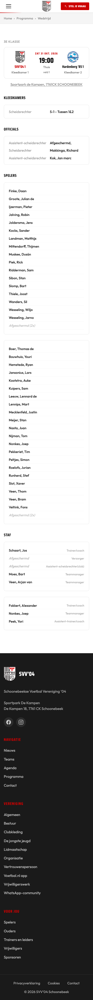

- **Programma:** drie filters (Thuis, Uit, Alle wedstrijden). Wedstrijden gegroepeerd per dag ("Zaterdag 31 oktober 2026"), per rij tijd, thuis of uit, sportpark, status zoals "Afgelast" en beide teams. Elke rij opent de wedstrijd.
- **Wedstrijddetail:** klasse ("3e klasse"), beide teams met logo, datum, tijd, "Thuis", veldnummer en kleedkamers; link naar het adres van het sportpark; blok Kleedkamers (kleedkamer per team, scheidsrechterskleedkamer); blok Officials (scheidsrechter, assistenten); selectie per team; staf per team met functie.

### D5. Agenda

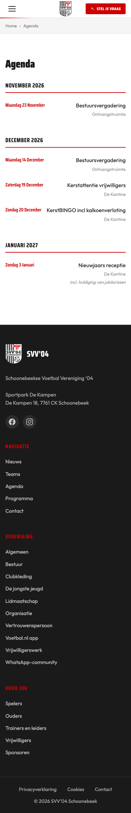

Per maand een kop met rode lijn. Per activiteit: datum ("Maandag 23 november"), titel, plaats ("Ontvangstruimte", "De Kantine") en soms een toelichting in cursief. Voorbeelden nu: Bestuursvergadering, Kerstattentie vrijwilligers, KerstBINGO incl. kalkoenenverloting, Nieuwjaars receptie. De activiteiten komen uit Club.Dataservice.

### D6. Assistent "Stel je vraag"

Er zijn twee vormen met dezelfde inhoud: de losse pagina `/assistent` en een paneel dat vanuit de rode knop in de header over het scherm schuift (ook vanaf elke pagina).

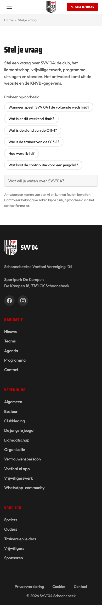
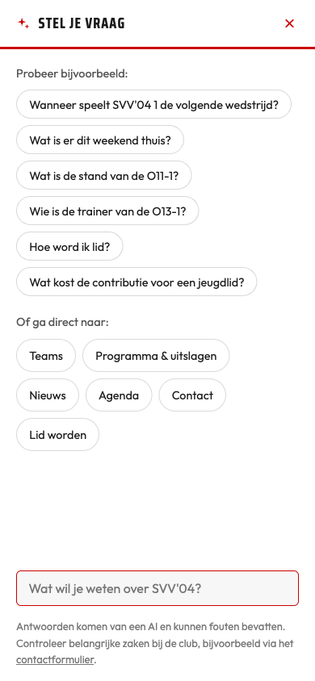
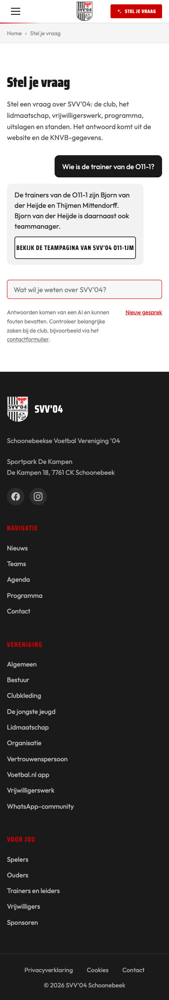
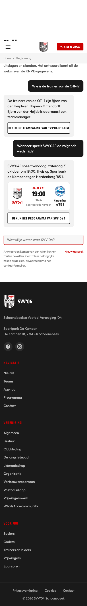

Opties en gedrag:

- **Startstaat:** korte uitleg ("Het antwoord komt uit de website en de KNVB-gegevens"), zes voorbeeldvragen als chips (volgende wedstrijd van SVV'04 1, wat is er dit weekend thuis, stand van de O11-1, trainer van de O13-1, hoe word ik lid, contributie jeugdlid). Het paneel toont ook zes snelkoppelingen "Of ga direct naar": Teams, Programma & uitslagen, Nieuws, Agenda, Contact, Lid worden.
- **Invoer:** een regel tekst, maximaal 500 tekens, verzenden met Enter of de knop.
- **Antwoord:** korte tekst (antwoord eerst), gevolgd door kaarten. Gezien: een knop "Bekijk de teampagina van SVV'04 O11-1JM" en een wedstrijdkaart (SVV'04 1, ZA 31 OKT, 19:00, Thuis, Sportpark de Kampen, Hardenberg '85 1) met knop "Bekijk het programma van SVV'04 1". Volgens de code kan een antwoord ook een contactkaart, een stand of een paginaknop bevatten.
- **Gesprek:** meerdere vragen onder elkaar, het gesprek blijft bij herladen staan, "Nieuw gesprek" wist het.
- **Verplichte disclaimer onderaan:** "Antwoorden komen van een AI en kunnen fouten bevatten. Controleer belangrijke zaken bij de club, bijvoorbeeld via het contactformulier."
- Op "Voor jou"-pagina's krijgt de assistent de rol van de pagina mee en komen de voorbeeldvragen uit de veelgestelde vragen van die rol.
- Wachttijd van een antwoord is een paar seconden. Er is geen ontworpen laad- of foutstaat bekeken.

### D7. Contact

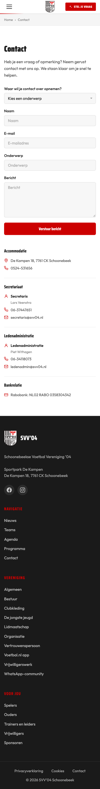
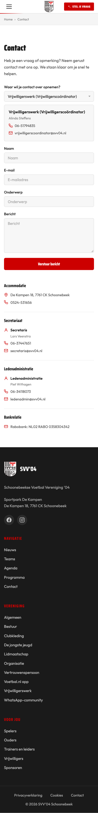

- Intro ("Heb je een vraag of opmerking? Neem gerust contact met ons op...").
- **Onderwerpkeuze (verplicht), 9 opties:** Algemeen (Secretaris), Accommodatie (Algemene zaken), Website (Beheerder), Sponsorgroep (Secretaris Sponsorgroep), Voetbal zaken (Voetbaltechnische zaken), Vrijwilligerswerk (Vrijwilligerscoördinator), Jeugd voetbal zaken (Coördinator jeugd), Contributie (Ledenadministratie), Materialen (Materiaalbeheer).
- Zodra een onderwerp is gekozen verschijnt een **contactkaart** met functie, naam, telefoon (tikbaar) en e-mail (tikbaar). Via `?afdeling=<slug>` is het onderwerp vooraf gekozen, bijvoorbeeld vanaf de "Voor jou"-pagina's.
- **Formulier:** Naam, E-mail, Onderwerp, Bericht en knop "Verstuur bericht". Beveiligd met BotID.
- **Vaste blokken eronder:** Accommodatie (adres, 0524-531656), Secretariaat, Ledenadministratie en Bankrelatie (Rabobank, IBAN).

### D8. "Voor jou"-pagina's

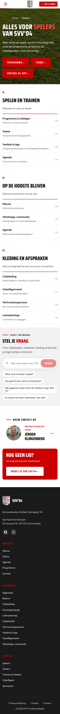
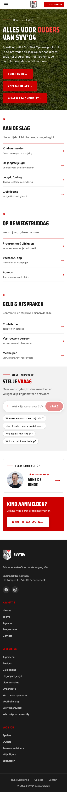
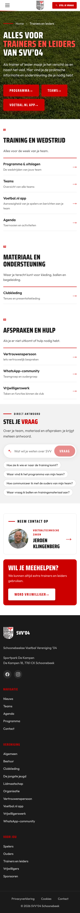
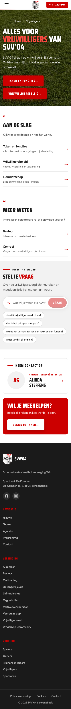

Elke pagina heeft een hero met accenttitel ("Alles voor *ouders* van SVV'04"), een intro en twee of drie knoppen, daarna genummerde linkgroepen, de assistentband, de contactkaart en een afsluitende CTA-balk. Inhoud per pagina:

| Pagina | Hero-knoppen | Groepen (met links) | Contactkaart | CTA |
| --- | --- | --- | --- | --- |
| Spelers | Programma, Teams, Voetbal.nl app | **Spelen en trainen:** Programma & uitslagen, Teams, Voetbal.nl app. **Op de hoogte blijven:** Agenda, Nieuws, WhatsApp-community. **Kleding en afspraken:** Clubkleding, Vrijwilligerswerk, Vertrouwenspersoon, Lidmaatschap | Voetbaltechnische zaken (Jeroen Klingenberg) | Word lid van SVV'04 |
| Ouders | Programma, Voetbal.nl app, WhatsApp-community | **Aan de slag:** Kind aanmelden, De jongste jeugd, Jeugdafdeling, Clubkleding. **Op de wedstrijddag:** Programma & uitslagen, Voetbal.nl app (afmelden), Agenda. **Geld & afspraken:** Contributie, Vertrouwenspersoon, Meehelpen | Coördinator jeugd (Anne de Jonge) | Kind aanmelden? Word lid |
| Trainers en leiders | Programma, Teams, Voetbal.nl app | **Training en wedstrijd:** Programma & uitslagen, Teams, Voetbal.nl app (aanwezigheid), Agenda. **Materiaal en ondersteuning:** Clubkleding. **Afspraken en hulp:** Vertrouwenspersoon, WhatsApp-community, Vrijwilligerswerk | Voetbaltechnische zaken (Jeroen Klingenberg) | Wil je meehelpen? Word vrijwilliger |
| Vrijwilligers | Taken en functies, Vrijwilligersbeleid | **Aan de slag:** Taken en functies, Vrijwilligersbeleid. **Meer weten:** Lidmaatschap, Bestuur, Contact | Vrijwilligerscoördinator (Alinda Steffens) | Bekijk de taken |
| Sponsoren | zie D10 | zie D10 | | |

### D9. Vereniging (tekstpagina's)

Alle pagina's gebruiken richtext met eigen blokken. Op desktop staat er een zijmenu "Vereniging pagina's" met de andere pagina's uit de sectie. Op mobiel valt dat menu weg, in de screenshots staat het als lijst onderaan.

| Pagina | Hoofdonderdelen (koppen) | Opvallende blokken |
| --- | --- | --- |
| Algemeen | Introductie, overzicht van de pagina's | |
| Bestuur | Bestuursleden: Ingrid Staal, Lars Veenstra, Henk Schuurhuis, Jeroen Klingenberg, Erwin Steffens | `boardMembersBlock`: ronde foto, naam, functie, taakgebieden als chips, telefoon en e-mail |
| Organisatie | Voetbal (Technische commissie, Wedstrijdsecretaris, Scheidsrechterscoördinator, HJO, Consul), Vereniging (Algemeen coördinator, Ledenadministratie, Materialenbeheer, Vrijwilligerscoördinator, Vertrouwenspersoon, Kantinebeheer, Sponsorcommissie, Club van 50, Website) | `teamDirectoryBlock`: "wie is wie" per functie |
| Lidmaatschap | Jeugd en ouders, Vrijwilligerswerk, Contributie, Tarieven, Betalen, Vragen, Opzeggen | `pricingTableBlock`, `ctaBlock` |
| Vrijwilligerswerk | Jeugd en ouders, Taken en functies, Vrijwilligersplan, Vragen? | `documentDownloadBlock`, `ctaBlock` |
| Vrijwilligerstaken | Jeugd/trainen/wedstrijden, Sportpark en ordedienst, Kantine, Accommodatie en materiaal, Overig | `taskTableBlock` met tijdsbesteding |
| Clubkleding | Bestellen via de webshop, Passen en kopen in de winkel, Wedstrijdtenue en presentatiekleding, Zelf kleding regelen | `ctaBlock` naar de webshop |
| De jongste jeugd | De trainingen, Twee keer gratis meedoen, Wat heb je nodig, Van puppy's naar JO-12, Normen en waarden, Onze trainers, Assistenten gezocht, Vragen? | `ctaBlock`, `contactBlock` |
| Voetbal.nl app | Wat is de app, Downloaden, Account aanmaken, SVV'04 instellen als favoriete club, Voor ouders | `appStoreButtonsBlock`, `qrCodeBlock` |
| WhatsApp-community | Zo werkt het, Wat zit er in, Privacy, Overige informatiekanalen, Vragen? | `qrCodeBlock`, `ctaBlock` |
| Vertrouwenspersoon | Korte pagina met contactgegevens | `contactBlock` |
| Advertenties aanleveren | Formaten, Bestandseisen, Wijzigingen doorgeven, Bestanden sturen | `adFormatsBlock` (formaten op schaal) |

Screenshots: [Algemeen](app-design/screens/mobile-vereniging-algemeen.png), [Bestuur](app-design/screens/mobile-vereniging-bestuur.png), [Organisatie](app-design/screens/mobile-vereniging-organisatie.png), [Lidmaatschap](app-design/screens/mobile-vereniging-lidmaatschap.png), [Vrijwilligerswerk](app-design/screens/mobile-vereniging-vrijwilligerswerk.png), [Vrijwilligerstaken](app-design/screens/mobile-vereniging-taken.png), [Clubkleding](app-design/screens/mobile-vereniging-clubkleding.png), [De jongste jeugd](app-design/screens/mobile-vereniging-jongste-jeugd.png), [Voetbal.nl app](app-design/screens/mobile-vereniging-voetbal-nl-app.png), [WhatsApp-community](app-design/screens/mobile-vereniging-whatsapp.png), [Vertrouwenspersoon](app-design/screens/mobile-vereniging-vertrouwenspersoon.png), [Advertenties aanleveren](app-design/screens/mobile-vereniging-advertenties-aanleveren.png).

De koppen komen uit de preview. Welk blok precies op welke pagina staat is een indicatie op basis van de pagina-inhoud en moet bij het uitwerken van een scherm worden nagekeken in het CMS.

### D10. Sponsoren

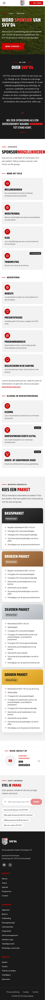
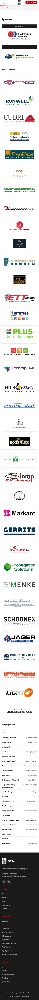

- **Sponsoring (`/sponsoring`):** "Word sponsor van SVV'04", "Over SVV'04", "Sponsormogelijkheden" (drie kaartgroepen: Rond het veld, Adverteren, Kleding en hoofdsponsoring), "Kies een pakket" (kaarten per niveau, bewust zonder prijs) en de assistentband.
- **Alle sponsors:** twee lijsten, Website sponsoren en Overige sponsoren, met logo's die naar de sponsor linken.
- De sponsorticker op de homepage laat dezelfde logo's doorlopen.

### D11. Tribune-actie

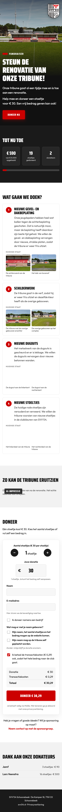

Losse pagina, niet in het menu. Van boven naar beneden: titel "Steun de renovatie van onze tribune!", korte oproep met knop "Doneer nu"; voortgang ("Tot nu toe": bedrag, doel € 8.000, aantal stoeltjes, aantal donateurs); "Wat gaan we doen?" met vier genummerde onderdelen (gevel- en dakbeplating, schilderwerk, dugouts, stoeltjes), elk met twee foto's "Huidige staat"; een AI-impressie van het resultaat met uitleg dat het echte resultaat kan afwijken; het **donatieformulier**; "Dank aan onze donateurs".

Donatieformulier: aantal stoeltjes (€ 30 per stuk, plus en min), of een vrij bedrag, naam, e-mailadres, "Ik doneer namens een bedrijf" en een keuze wat er met de naam mag gebeuren (bijvoorbeeld tonen met het aantal stoeltjes). Daarna betaling via Mollie. Het formulier is beveiligd met BotID.

### D12. Privacy en cookies

[Privacy](app-design/screens/mobile-privacy.png) en [Cookies](app-design/screens/mobile-cookies.png): lange tekstpagina's met kopjes. De privacyverklaring noemt onder meer ledenadministratie, staf per team, donaties en de assistent. In een app is dit een gewone tekstweergave, maar de store eist een link naar de privacyverklaring.

## E. Wat de app van de site kan overnemen, en wat niet

| Onderdeel | Overnemen? | Opmerking |
| --- | --- | --- |
| Homepage-opbouw | Als inspiratie | Hero, assistent, wedstrijden, nieuws, agenda, rolkeuze. Op mobiel is dit al een lange scroll |
| Rolkeuze Speler, Ouder, Trainer, Vrijwilliger, Sponsor | Ja, als onboarding of filter | Beïnvloedt welke links en voorbeeldvragen je ziet |
| Assistent | Ja, centraal | Bestaand endpoint, antwoorden bevatten kaarten |
| Teampagina met tabs | Ja | Stand, programma, uitslagen zijn de meest gebruikte data |
| Programma voor het hele club | Alleen "mijn team" | De KNVB-app doet de rest. Zie §5 |
| Wedstrijddetail | Klein deel | Zie opmerking over persoonsgegevens in F |
| Agenda | Ja | Kleine lijst, past op een tab of in Home |
| Vereniging-pagina's | Als lijst met tekstpagina's | Eén generieke tekstweergave met blokken |
| Tribune en donaties | Doorlinken | Zie §10 en open vraag 4 |
| Contact | Ja | Onderwerpkeuze plus contactkaart is sterk en past goed op mobiel |

## F. Bevindingen tijdens het in kaart brengen

Dit zijn dingen die opvielen en die voor het ontwerp of de club relevant zijn. Ze zijn niet opgelost.

1. **Persoonsgegevens op de wedstrijdpagina.** Het detail toont de volledige selectie en staf van beide teams, met voor- en achternaam (spelers die dat niet willen zijn "Afgeschermd"). Voor de app is dit een besluit: tonen, beperken tot de eigen teams of weglaten. Zie open vraag 6.
2. **Tarieven.** De pagina Lidmaatschap heeft de kop "Tarieven seizoen 2024-2025", terwijl het seizoen 2026-2027 loopt. Controleer of de tarieven actueel zijn voordat ze in een app komen.
3. **Tribune-cijfers.** De preview toont € 590 van € 8.000, 19 stoeltjes en 2 donateurs. Dit lijken testdonaties. Gebruik ze niet als voorbeeldgegevens in een ontwerp zonder dat te markeren.
4. **Feedback-widget en zoekvenster** staan in de code maar zijn niet actief (zie §3).
5. **`/meedoen`** geeft een 404 maar de route bestaat nog.
6. **Voetbal.nl app** staat op elke "Voor jou"-pagina twee keer als link (hero-knop en linkgroep).
7. **Teams in het mobiele menu.** Op mobiel is "Teams" een gewone link, op desktop een uitklap met alle 23 teams. In de app is een teamkeuze waarschijnlijk een eigen scherm of een favoriet.
8. **De assistent is traag genoeg om een laadstaat te vragen** (een paar seconden per antwoord) en heeft nu geen ontworpen foutstaat.
9. **De site heeft nog geen donker thema** en geen aparte staat voor "geen internet".

## G. Lijst van de screenshots

Alle bestanden staan in `docs/app-design/screens/`. Mobiel is 390 px breed, volledige paginalengte; "viewport" is alleen het eerste scherm.

| Groep | Bestanden |
| --- | --- |
| Navigatie | `desktop-menu-vereniging`, `desktop-menu-voor-jou`, `desktop-menu-teams`, `mobile-menu` |
| Home | `mobile-home`, `mobile-home-viewport`, `desktop-home`, `desktop-home-viewport` |
| Nieuws | `mobile-nieuws`, `mobile-nieuws-detail`, `mobile-nieuws-detail-vacature` |
| Teams | `mobile-teams`, `mobile-team-detail-senior`, `mobile-team-detail-senior-viewport`, `mobile-team-detail-jeugd`, `mobile-team-tab-programma`, `-uitslagen`, `-indeling`, `-beker` |
| Wedstrijden en agenda | `mobile-programma`, `mobile-wedstrijd-detail`, `mobile-agenda` |
| Assistent | `mobile-assistent`, `mobile-assistent-viewport`, `mobile-assistent-paneel`, `mobile-assistent-antwoord-team`, `mobile-assistent-antwoord-wedstrijd` |
| Contact | `mobile-contact`, `mobile-contact-afdeling-diep` |
| Voor jou | `mobile-voor-spelers`, `-ouders`, `-trainers-leiders`, `-vrijwilligers`, `mobile-sponsoring` |
| Vereniging | `mobile-vereniging-*` (12 pagina's) |
| Overig | `mobile-alle-sponsors`, `mobile-tribune`, `mobile-privacy`, `mobile-cookies` |
